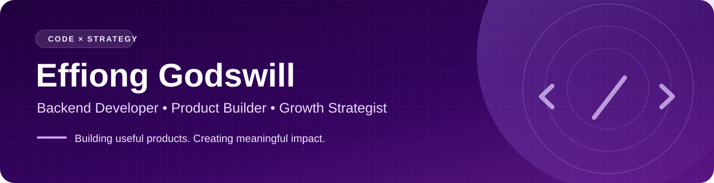
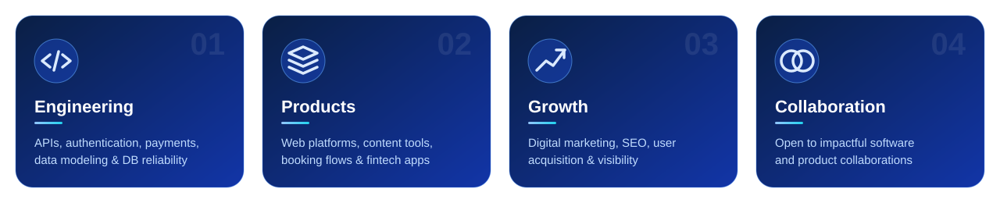
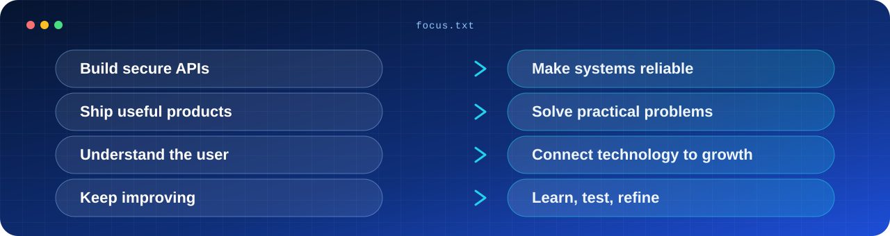

  

### 👋 Hello, I'm Godswill

**I build dependable software and turn ideas into products people can use.**

Based in Nigeria 🇳🇬 · Interested in backend systems, product engineering, and digital growth

### 🧭 About me

I'm a **software developer and digital product enthusiast** with hands-on experience building web applications, backend APIs, authentication flows, and database-driven services.

My work sits at the intersection of **engineering, product thinking, and growth**. I care about systems that are secure, maintainable, and useful—not just code that runs.

### 🛠️ Technology & tools

**Backend & data**

**Web & workflow**

### ✨ Selected public work

| Project | What you'll find |
| :--- | :--- |
| [**GleegX TV**](https://github.com/DONNWILZY/gleegxTv) | Content-platform concepts and backend workflows |
| [**Authentication & email verification**](https://github.com/DONNWILZY/Login_Signup_auth-emailVerification) | A project focused on sign-up, sign-in, and email verification |
| [**Booking System**](https://github.com/DONNWILZY/bookingSystem) | A frontend booking experience using HTML, CSS, and vanilla JavaScript |
| [**Personal Website**](https://github.com/DONNWILZY/godswilleffiong) | My personal web presence and experiments |

### 🎯 What I'm focused on

### 📊 GitHub snapshot

  
  

 

